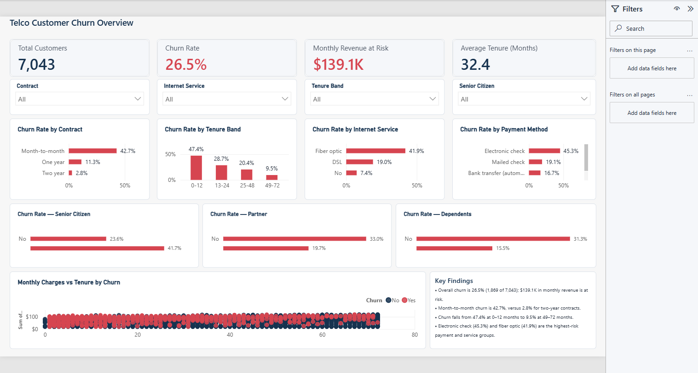
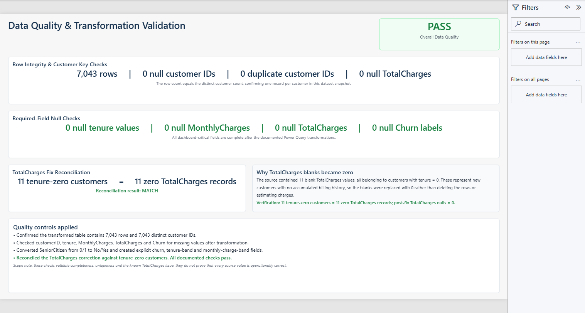

# Telco Customer Churn Analysis — Power BI and Machine Learning

An employer-facing analytics portfolio project that combines an interactive Power BI dashboard with a Python machine-learning notebook. It analyzes 7,043 telecom customers, highlights which groups are most likely to churn, and demonstrates both business intelligence and predictive-analysis skills.

**Repository:** [7illz/Telco-Customer-Churn-Prediction](https://github.com/7illz/Telco-Customer-Churn-Prediction)

## Project scope

- **Power BI:** An interactive two-page management dashboard covering churn KPIs, customer segments, tenure, contracts, service and payment behavior, revenue at risk, and data quality.
- **Machine learning:** A Python notebook comparing Logistic Regression, K-Nearest Neighbors, and an Artificial Neural Network. The notebook's evaluation identifies Logistic Regression as the strongest tested model, with 80.52% test accuracy.

## Dashboard summary

The report contains two pages:

1. **Churn Overview** — KPI cards, interactive slicers, segment comparisons, contract and tenure analysis, payment and internet-service breakdowns, and a monthly-charge-versus-tenure scatter plot.
2. **Data Quality** — row-count, null, duplicate-ID, and `TotalCharges` reconciliation checks.

The main page supports filtering by contract, internet service, tenure band, and senior-citizen status. Tooltips on the rate charts show the supporting customer and churn counts.

## Verified findings

- Overall churn is **26.5%**: 1,869 of 7,043 customers. Churned customers represent **$139,130.85** in monthly revenue at risk.
- Month-to-month customers have a **42.7%** churn rate, compared with **11.3%** for one-year and **2.8%** for two-year contracts.
- Churn falls from **47.4%** among customers with 0–12 months of tenure to **9.5%** among customers with 49–72 months.
- Electronic-check customers have the highest payment-method churn rate at **45.3%**, while fiber-optic customers have the highest internet-service churn rate at **41.9%**.

These findings are descriptive associations in this dataset; they do not by themselves establish causation.

## Data preparation

Power Query performs the following transformations:

- Sets text, whole-number, currency, and decimal data types.
- Converts the 11 blank `TotalCharges` values to zero only when `tenure = 0`. These records are new customers with no completed billing period, so zero preserves the valid rows without inventing accumulated revenue.
- Converts `SeniorCitizen` from `0/1` to `No/Yes`.
- Adds `Churn Flag` (`1` for churn and `0` for retained).
- Adds tenure bands: `0-12`, `13-24`, `25-48`, and `49-72` months.
- Adds monthly-charge bands: `Low` below $35, `Medium` from $35 to below $70, and `High` from $70 upward.

The completed semantic model contains 17 measures, including Total Customers, Churned Customers, Churn Rate, average charges and tenure, Revenue at Risk, Churn Rate vs Overall, and data-quality controls.

## Data-quality result

The quality checks return **PASS**:

- 7,043 rows
- 0 null customer IDs
- 0 duplicate customer IDs
- 0 null tenure values
- 0 null monthly-charge values
- 0 null `TotalCharges` values after correction
- 0 null churn labels
- 11 tenure-zero customers reconciled to 11 zero-`TotalCharges` records

## Project files

- `17_22241013__22241055 (2).ipynb` — Python machine-learning and deep-learning workflow
- `Telco Churn Dashboard/Telco Churn Dashboard.pbip` — editable Power BI project entry point
- `Telco Churn Dashboard/Telco Churn Dashboard.Report/` — report definition in PBIR format
- `Telco Churn Dashboard/Telco Churn Dashboard.SemanticModel/` — semantic model and TMDL definitions
- `deliverables/Telco Churn Dashboard.pdf` — exported two-page report
- `deliverables/dashboard-overview.png` — portfolio screenshot
- `deliverables/data-quality.png` — quality-page screenshot
- `Telco-Customer-Churn.csv` — source dataset
- `Telco Churn Power Query.m` — documented Power Query transformation script

To open the finished project on Windows, install Power BI Desktop and double-click `Telco Churn Dashboard.pbip`. If the CSV is moved, update the `Source` step in Power Query to its new path and select **Refresh**.

## Suggested management actions

- Prioritize retention outreach during the first 12 months of the customer lifecycle.
- Test incentives that move suitable month-to-month customers toward longer contracts.
- Review onboarding, service expectations, and support experience for fiber-optic customers.
- Test payment-method migration campaigns for electronic-check customers and measure the effect on churn and revenue at risk.

These actions should be evaluated through controlled pilots before broad rollout.

## 30-second interview explanation

> I built this Power BI dashboard from a 7,043-row telco churn dataset. In Power Query, I corrected the tenure-zero TotalCharges blanks, standardized the fields, and created customer segmentation bands. I then built DAX measures for customer counts, churn rate, average tenure, and monthly revenue at risk. The dashboard shows that churn is concentrated among month-to-month, early-tenure, electronic-check, and fiber-optic customers. I also added a data-quality page that reconciles the TotalCharges fix and checks key fields for missing or duplicate records.

## Likely interview questions

**Why compare churn rates instead of only churned-customer counts?**

Rates normalize for segment size. A large segment can have many churned customers but a moderate risk level, while a smaller segment may have fewer churners but a much higher probability of churn.

**Why replace the blank `TotalCharges` values with zero?**

Every blank belongs to a customer with zero months of tenure. Zero therefore represents no accumulated billing history, keeps valid new-customer records in the model, and is confirmed by the 11-to-11 reconciliation on the Data Quality page.

**What action would you recommend first?**

I would pilot a first-year retention program for month-to-month customers, with targeted onboarding, contract-migration offers, and payment-method nudges. I would track incremental churn reduction and monthly revenue retained against a control group.

## GitHub presentation

This repository includes the original predictive-modeling notebook and the completed Power BI portfolio extension. The dashboard screenshot renders directly in GitHub, while the PBIP source, semantic model, PDF, data-quality evidence, Power Query script, and DAX definitions make the work reviewable and reproducible.
